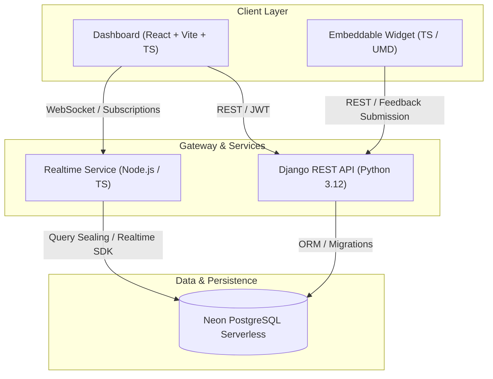

# IdeaRelay Architecture

IdeaRelay is a multi-tenant SaaS feedback management platform designed for high performance, tenant isolation, and live synchronization.

## Monorepo Layout

- **`frontend/dashboard`**: Main customer web application built with React, Vite, TypeScript, Tailwind CSS, React Router, TanStack Query, and Redux Toolkit.
- **`frontend/widget`**: Embeddable JavaScript feedback collection widget.
- **`backend/django`**: Core business logic, authentication, permission checks, and REST APIs powered by Django and Django REST Framework.
- **`backend/realtime`**: High-throughput subscription gateway verifying JWT tokens and sealing queries for Neon Realtime event streams.
- **`infrastructure`**: Docker Compose, Dockerfiles, and deployment configs.
- **`docs`**: Technical designs, API contracts, database specifications, and integration instructions.

## Key Principles

1. **Multi-Tenancy**: Organization and project-level isolation enforced at database and API layers.
2. **Separation of Concerns**: Business logic isolated in Django service layers, keeping views lean.
3. **Type Safety**: TypeScript strict mode across frontend and realtime services.
4. **Resilience & Testing**: Comprehensive unit and integration test coverage across all packages.
