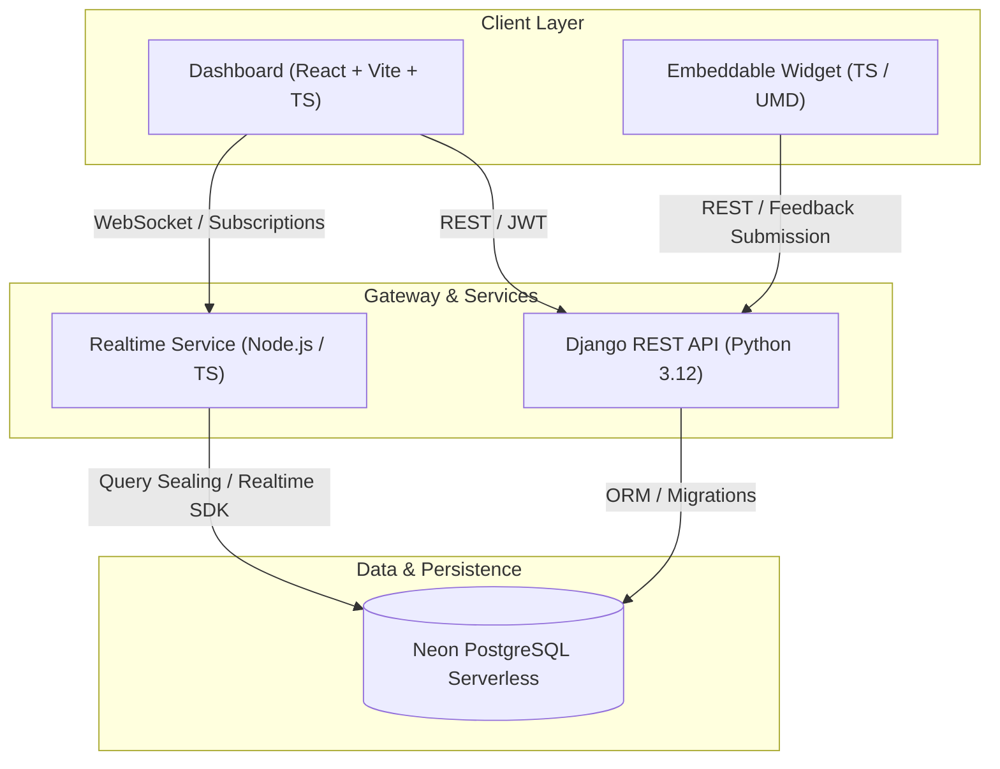
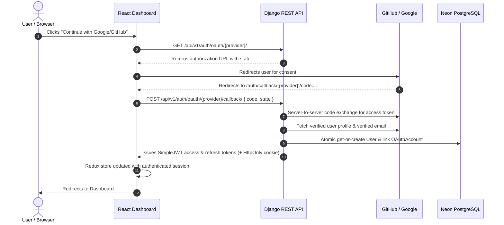

# IdeaRelay Architecture

IdeaRelay is a multi-tenant SaaS feedback management platform designed for high performance, tenant isolation, and live synchronization.

## Authentication & Identity Architecture (Phase 2)

IdeaRelay implements a unified multi-method authentication system supporting:
1. **Traditional Email & Password**: Scoped to a custom user model using PBKDF2/SHA256 password hashing.
2. **GitHub OAuth 2.0**: Direct code exchange with verified primary email resolution.
3. **Google OAuth 2.0 (OpenID Connect)**: OIDC authorization code exchange with email verification check.

### Unified Identity Model

All authentication methods map to the same `User` record. Third-party providers are stored in a decoupled `OAuthAccount` table:

### Token Lifecycle & Security
- **Access Tokens**: Short-lived (60 minutes), held in-memory in the React SPA.
- **Refresh Tokens**: Long-lived (7 days), stored in secure `HttpOnly`, `SameSite=Lax` cookies with token rotation and blacklisting on logout.
- **Verification & Reset**: Stateless cryptographic HMAC tokens (`urlsafe_base64_encode(user.id) + token`) with 24-hour expiration window.
- **Safeguard Rules**: A user must retain at least one usable authentication method (either a password or at least one linked OAuth provider) before unlinking.

## Monorepo Layout

- **`frontend/dashboard`**: Main customer web application built with React, Vite, TypeScript, Tailwind CSS, React Router, TanStack Query, and Redux Toolkit.
- **`frontend/widget`**: Embeddable JavaScript feedback collection widget.
- **`backend/django`**: Core business logic, authentication, permission checks, and REST APIs powered by Django and Django REST Framework.
- **`backend/realtime`**: High-throughput subscription gateway verifying JWT tokens and sealing queries for Neon Realtime event streams.
- **`infrastructure`**: Docker Compose, Dockerfiles, and deployment configs.
- **`docs`**: Technical designs, API contracts, database specifications, and integration instructions.

## Key Principles

1. **Multi-Tenancy**: Organization and project-level isolation enforced at database and API layers.
2. **Separation of Concerns**: Business logic isolated in Django service layers (`AuthService`, `OAuthService`, `EmailService`), keeping views lean.
3. **Type Safety**: TypeScript strict mode across frontend and realtime services.
4. **Resilience & Testing**: Comprehensive unit and integration test coverage across all packages (Pytest + Vitest).
