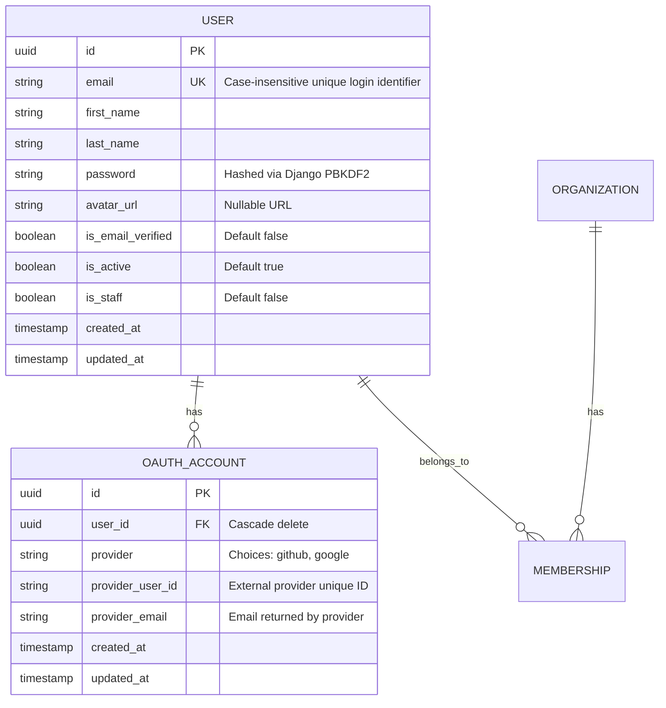
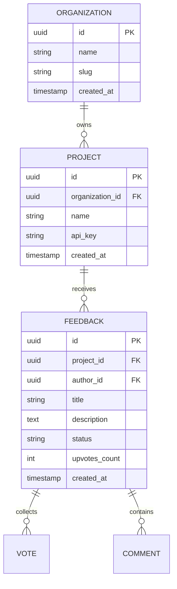

# IdeaRelay Database Design

IdeaRelay utilizes **Neon PostgreSQL** serverless database, taking advantage of branching, connection pooling, and Neon Realtime replication.

## Authentication & User Models (Phase 2)

### Table Specifications

#### 1. `users_user`
- **`id`**: `UUID` primary key (default `uuid_generate_v4()`).
- **`email`**: `VARCHAR(255)` unique index, lowercase normalized.
- **`first_name`** / **`last_name`**: `VARCHAR(150)`.
- **`avatar_url`**: `VARCHAR(1024)` nullable.
- **`is_email_verified`**: `BOOLEAN` default `FALSE`.
- **`is_active`**: `BOOLEAN` default `TRUE`.
- **`is_staff`**: `BOOLEAN` default `FALSE`.
- **`created_at`** / **`updated_at`**: `TIMESTAMPTZ`.

#### 2. `users_oauthaccount`
- **`id`**: `UUID` primary key.
- **`user_id`**: Foreign Key referencing `users_user.id` (`ON DELETE CASCADE`).
- **`provider`**: `VARCHAR(32)` (`github` | `google`).
- **`provider_user_id`**: `VARCHAR(255)`.
- **`provider_email`**: `VARCHAR(255)`.
- **Constraints**:
  - `UniqueConstraint(fields=['provider', 'provider_user_id'], name='unique_provider_user')`
  - `UniqueConstraint(fields=['user', 'provider'], name='unique_user_provider_account')`

---

## Multi-Tenant Schema (Subsequent Phases)

Tenant isolation is maintained through tenant scoping (`organization_id` and `project_id`) across core entity models:

