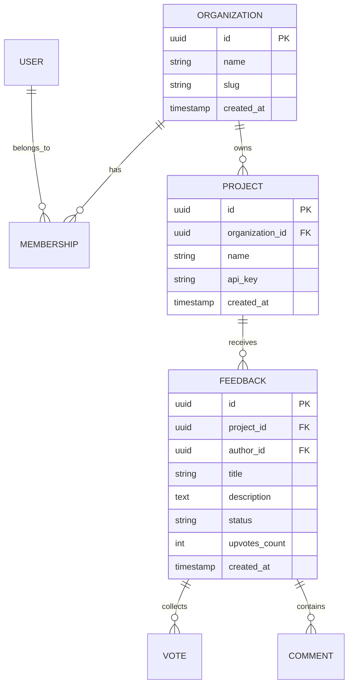

# IdeaRelay Database Design

IdeaRelay utilizes **Neon PostgreSQL** serverless database, taking advantage of branching, connection pooling, and Neon Realtime replication.

## Multi-Tenant Isolation Strategy

Tenant isolation is maintained through tenant scoping (`organization_id` and `project_id`) across core entity models:

## Neon Realtime Integration

- Query sealing is utilized to authorize client subscriptions securely without exposing raw database credentials to clients.
- Logical replication streams feed realtime changes into subscribed dashboard views.
